  

  

<b>Русский</b> &nbsp;·&nbsp; <a href="README.en.md">English</a>

Привет! Я **ShadowDemonHD**, разработчик, получаю высшее образование. Пишу на Python, JavaScript и Rust: десктоп-приложения, сайты и инструменты для разработки.

  
  
  
  

**Языки** 
     

**Инструменты** 
       

 &nbsp;**[Cuboserver Team](https://cuboserver.net)**: работал на позициях Community Manager, Tester

